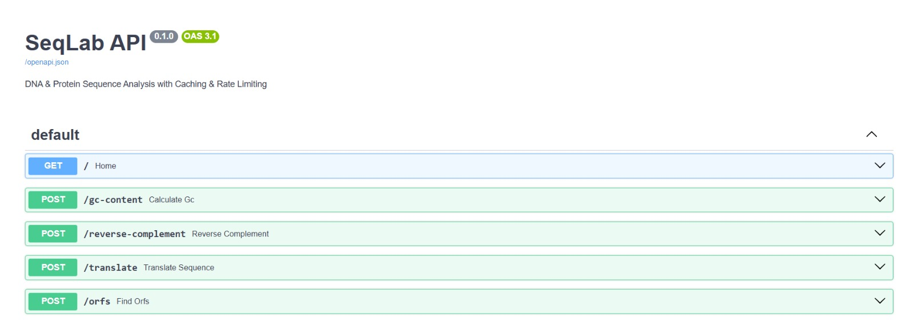
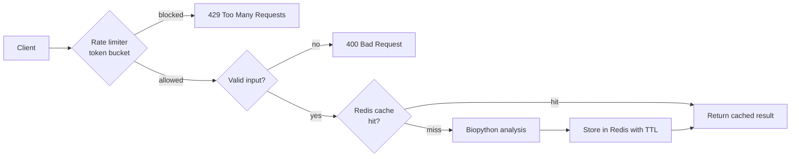
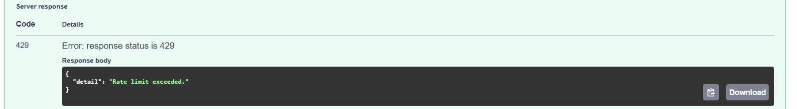

#  SeqLab

A fast, rate-limited REST API for DNA sequence analysis, built with **FastAPI**, **Biopython** and **Redis**.

**Live demo:**(https://seqlab.onrender.com/docs) &nbsp;|&nbsp; **Stack:** Python · FastAPI · Biopython · Redis · Docker

> `/docs` is an interactive Swagger UI: try every endpoint in the browser, no setup needed. The demo runs on a free tier, so the first request after inactivity can take 30-60 seconds to wake up.


---

## What it does

SeqLab accepts a DNA sequence as JSON and returns common analyses:

| Endpoint | Description |
|---|---|
| `POST /gc-content` | Sequence length and GC percentage |
| `POST /reverse-complement` | Reverse complement strand |
| `POST /translate` | Translate DNA to a protein sequence |
| `POST /orfs` | Find open reading frames (forward strand, 3 frames) |
| `GET /` | Health check, reports whether Redis is connected |

Every analysis response includes `cached` (served from Redis or not) and `response_time_ms` (server-side processing time).




---

## Architecture



Redis does two jobs: **caching analysis results** and **storing rate-limit buckets**.

---

## Design decisions (the "why")

**Cache-aside with Redis.** Sequence analysis is deterministic: the same input and operation always give the same output. Results are cached under a SHA-256 key of `(operation, sequence)` with a 60-second TTL, so repeat requests skip the computation. I chose cache-aside (the app checks and fills the cache itself) because there is nothing to write back and the cache can be wiped safely without losing data. Lookups use a single `GET` rather than `EXISTS` + `GET`, which avoids a race where a key expires between the two calls.

**Token bucket rate limiting, written by hand.** Each client IP has a bucket of **5 tokens** that refills at **1 token per second**: short bursts are allowed, but the sustained rate is capped at about 1 request/second. A fixed window can let through double the limit across a window boundary; a token bucket cannot. The limiter runs *before* validation, caching and analysis, so rejected requests cost almost nothing. Over-limit requests get `429` with a `Retry-After: 1` header.

**Redis instead of an in-memory dictionary.** An in-process dict is lost on restart and breaks with more than one app instance. Redis keeps cache and rate-limit state shared.

**Fails open.** If Redis is unreachable, the API still works: it computes every request directly and skips rate limiting, rather than returning errors. Availability over strictness.

**Proxy-aware client IP.** Behind Render's proxy, the socket address is the proxy, not the user. The limiter reads `X-Forwarded-For` so each real client gets its own bucket.

**JSON request bodies.** Real sequences can be thousands of bases and URLs have length limits, so sequences go in the body.

**Input validation.** Empty sequences or characters outside `A, T, G, C, U, N` return a clean `400` with a message.

**Docker Compose.** One command runs the API and Redis locally with identical behaviour on any machine.

---

## Performance

ORF scan on a **6000-base** sequence, measured server-side on localhost (`response_time_ms` from the API response):

| Request | Avg response time | Samples |
|---|---|---|
| Cache miss | ~4.3 ms | 2 |
| Cache hit | ~0.46 ms | 8 |

Roughly a **9x reduction** for repeat requests. This is a small sample on one sequence and a local machine, so treat it as indicative of the effect, not a production benchmark. Cache entries expire after 60 seconds.

---

## Rate limiting



Exceeding the limit returns HTTP `429`:

```json
{ "detail": "Rate limit exceeded." }
```

---

## Quick start

**Docker (recommended):**

```bash
git clone https://github.com/Ruthi-L/seqlab.git
cd seqlab
docker compose up --build
```

API at `http://localhost:8000`, docs at `http://localhost:8000/docs`.

**Without Docker:**

```bash
python -m venv venv
source venv/bin/activate        # Windows: venv\Scripts\activate
pip install -r requirements.txt
# a Redis server must be running on localhost:6379
uvicorn main:app --reload
```

**Configuration (environment variables):**

| Variable | Purpose | Default |
|---|---|---|
| `REDIS_URL` | Full Redis URL (used in production). Takes priority. | not set |
| `REDIS_HOST` | Redis hostname (used by docker-compose) | `localhost` |

---

## Deployment

Deployed on **Render** as a Web Service, with a Render **Key Value** (Redis) instance in the same region.

- Build command: `pip install -r requirements.txt`
- Start command: `uvicorn main:app --host 0.0.0.0 --port $PORT`
- Environment variable: `REDIS_URL` = the Key Value instance's internal URL

Check `GET /`: `"redis_connected": true` confirms the cache is live.

---

## Example requests

**GC content**

```bash
curl -X POST 'http://localhost:8000/gc-content' \
  -H 'Content-Type: application/json' \
  -d '{"sequence": "ATGC"}'
```

```json
{ "cached": false, "response_time_ms": 0.19, "sequence": "ATGC", "length": 4, "gc_content_percent": 50.0 }
```

**Reverse complement**

```bash
curl -X POST 'http://localhost:8000/reverse-complement' \
  -H 'Content-Type: application/json' \
  -d '{"sequence": "AAGCC"}'
```

```json
{ "cached": false, "response_time_ms": 0.35, "original": "AAGCC", "reverse_complement": "GGCTT" }
```

**Translate**

```json
{ "cached": false, "response_time_ms": 0.2, "sequence": "ATGAAAGCTTGGCGTTAA", "protein": "MKAWR*" }
```

**Open reading frames**

```bash
curl -X POST 'http://localhost:8000/orfs' \
  -H 'Content-Type: application/json' \
  -d '{"sequence": "CCATGAAAGCTTGGCGTTAAGG"}'
```

```json
{
  "cached": false,
  "response_time_ms": 3.99,
  "sequence": "CCATGAAAGCTTGGCGTTAAGG",
  "orfs_found": 1,
  "orfs": [ { "frame": 3, "protein_length": 5, "protein": "MKAWR" } ]
}
```

Reading starts at the 3rd base: `CC | ATG AAA GCT TGG CGT TAA | GG` → `M K A W R` + stop. Repeating a request returns `"cached": true` with a much lower `response_time_ms`.

---

## Project structure

```
seqlab/
├── main.py              # FastAPI app: routes, caching, rate limiter, analysis
├── requirements.txt
├── Dockerfile
├── docker-compose.yml   # API + Redis
├── .gitignore
└── README.md
```

---

## Limitations and future work

- **Rate limiter is not atomic.** The read-modify-write on the bucket is not a single Redis operation, so heavy concurrent bursts from one IP could slip a few extra requests through. A Lua script or Redis transaction would fix this.
- **`X-Forwarded-For` can be spoofed** if the proxy does not overwrite it; a production setup would trust only the platform's proxy header.
- Per-IP limiting means clients behind a shared IP share one bucket.
- ORF finder scans the **forward strand only** and has no minimum-length filter, so short ORFs (even a lone `M`) are reported. Planned: reverse-strand scanning, a `min_length` option, and flagging ORFs with no stop codon.
- Partial trailing codons are dropped during translation.
- Benchmarks are a small local sample, not a load test.
- Planned: background job queue (Celery) for long analyses, NCBI accession lookup, a web frontend.

---

## Tech stack

Python · FastAPI · Biopython · Redis · Docker · Docker Compose · Render

---
